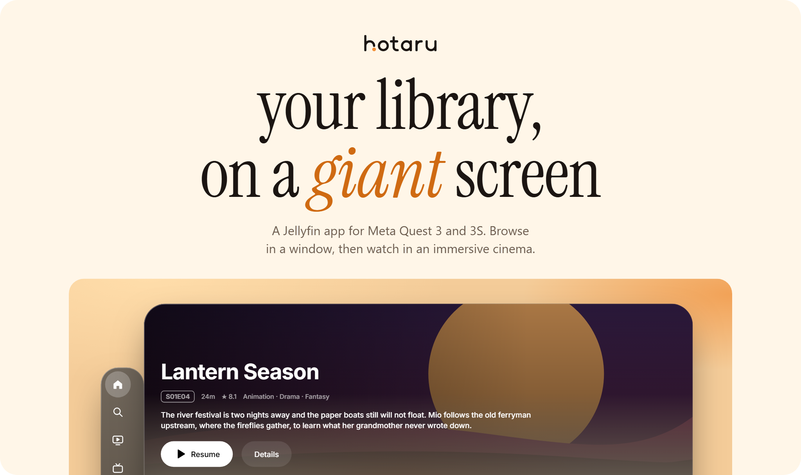
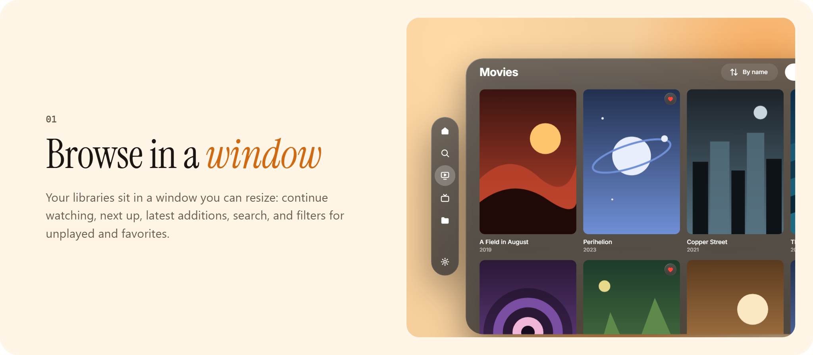
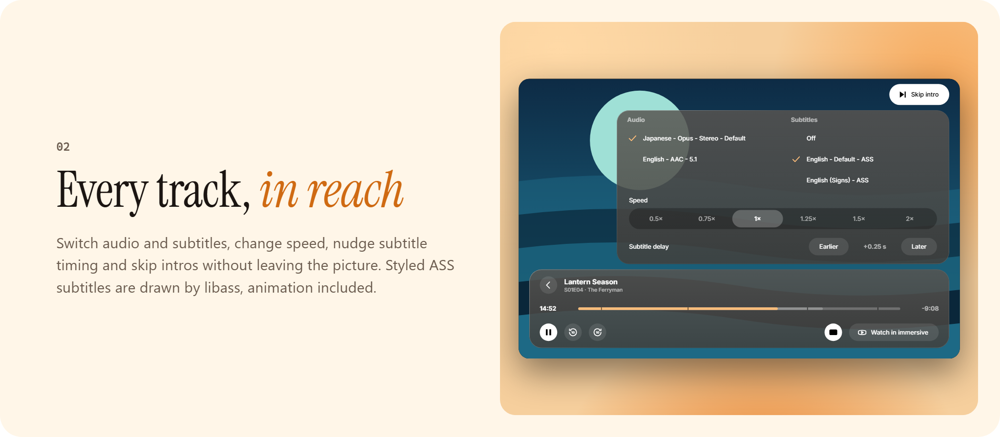
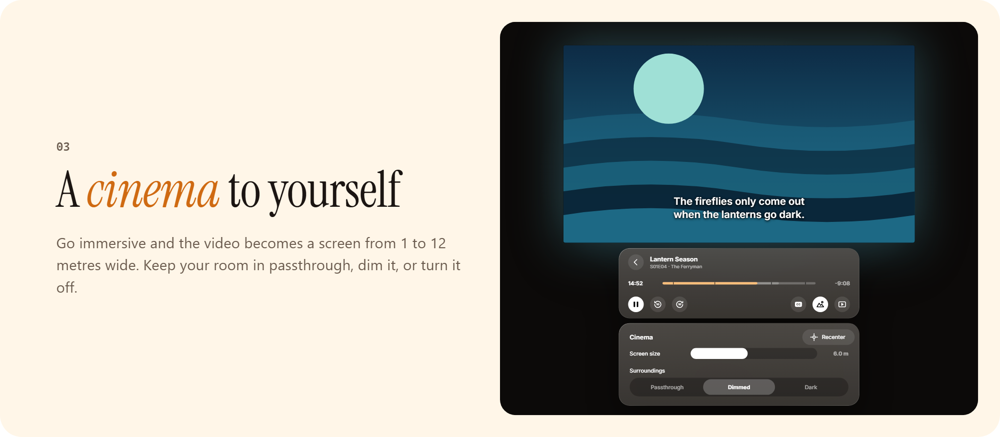

<picture>
  <source media="(prefers-color-scheme: dark)" srcset=".github/readme/hero-dark.png">
  
</picture>

<p align="center">
  <a href="https://www.meta.com/experiences/hotaru/1500675923122825/"><b>Get Hotaru on the Meta Horizon Store</b></a>
  &nbsp;·&nbsp;
  <a href="https://github.com/Anthonyy232/Hotaru/releases/latest"><b>Download the APK</b></a>
  &nbsp;·&nbsp;
  <a href="https://anthonyy232.github.io/Hotaru/"><b>Website</b></a>
</p>

Hotaru is a [Jellyfin](https://jellyfin.org) app for Meta Quest 3 and 3S. You browse your library in a window, play a video there, and move it at any point to an immersive cinema with a screen up to 12 metres wide.

Get it on the [Meta Horizon Store](https://www.meta.com/experiences/hotaru/1500675923122825/), or [download the APK](#install) and sideload it. It needs Horizon OS v69 or newer and a Jellyfin server on 12.0 or newer. The images on this page are renders drawn from the app's own colours and layout, with invented titles.

<picture>
  <source media="(prefers-color-scheme: dark)" srcset=".github/readme/feature-browse-dark.png">
  
</picture>

- **Home** features one item to resume or play, then rows for Continue Watching, Next Up and the latest additions to each library.
- **Libraries** each get a tab: movies, shows, home videos, music videos, collections, playlists and mixed folders. Sort by name, recently added or latest releases, and filter to unplayed or favorites. Music, books, photos and live TV libraries are not shown.
- **Search** covers movies, shows, episodes, collections and videos.
- **Details** has Play or Resume, From start, favorite and played toggles, seasons and episodes, and More like this.

The window resizes freely, down to 640 × 400 dp. Everything works with hands or controllers.

<picture>
  <source media="(prefers-color-scheme: dark)" srcset=".github/readme/feature-player-dark.png">
  
</picture>

- **Tracks**: pick any audio or subtitle track of the file. Speed runs from 0.5× to 2×, and subtitles can be shifted earlier or later in 0.25 s steps.
- **Subtitles**: SRT, ASS/SSA, WebVTT and TTML are drawn on the headset. Styled ASS tracks go through libass, so their fonts, positioning and animation are kept.
- **Seeking**: chapter marks on the seek bar, and preview thumbnails while you scrub when the server has trickplay images.
- **Segments**: intros, credits, and recaps and previews can each be skipped automatically, offered as a button, or left alone.
- **Formats**: Hotaru asks for direct play first, then a remux, then a transcode. Video uses the headset's hardware decoders only, and HDR is passed through where they support it. Audio the headset can decode is played directly and surround is downmixed to stereo; formats it cannot decode, such as DTS and TrueHD, are converted by the server.

Playback pauses when you take the headset off and resumes when you put it back on. Progress is reported to the server, so other clients show the same resume points, and other Jellyfin clients can cast to Hotaru and control it.

<picture>
  <source media="(prefers-color-scheme: dark)" srcset=".github/readme/feature-cinema-dark.png">
  
</picture>

**Watch in immersive** moves what is playing from the window to the cinema without restarting it, and **Watch in window** brings it back.

- **Screen size** goes from 1 to 12 metres wide with the slider, or grab the screen to move and resize it. **Recenter** puts it back in front of you.
- **Surroundings** is Passthrough, Dimmed or Dark.
- **3D** side-by-side and top-and-bottom videos play in stereo.
- **180° and 360°** videos surround you. Jellyfin has no field for this, so Hotaru goes by `180`, `360`, `vr180` or `vr360` in the file name or path.

## Connecting

Hotaru lists Jellyfin servers it finds on your network, and you can add one by address, such as `192.168.1.10:8096` or `https://jellyfin.example.com`. Servers you have used are remembered until you remove one with the bin on its row, which also removes the sign-ins saved for it.

Sign in by picking a user and entering the password, or with **Quick Connect**: Hotaru shows a code, and you enter it in Jellyfin on your phone or computer.

Plain `http` servers work, as do `https` servers with a certificate authority you have installed on the headset. Sign-in tokens are stored encrypted with a key from the Android Keystore. **Switch user** keeps the account for next time; **Sign out and forget** also ends its session on the server.

## Settings

- **Maximum quality**: 20, 40, 80 or 120 Mbps, or Original.
- **Audio**: downmix on the headset, or have the server send stereo AAC.
- **Subtitle size**: Small, Medium, Large or Extra large.
- **Force SDR output**: never ask the server for HDR.
- **Autoplay next episode**.
- **Skip segments**: Skip automatically, Ask or Never, set separately for intros, credits, and recaps and previews.
- **Cinema surroundings**: the default for the immersive cinema.

## Install

Install it from the [Meta Horizon Store](https://www.meta.com/experiences/hotaru/1500675923122825/).

To sideload instead, download `hotaru-<version>.apk` from the [latest release](https://github.com/Anthonyy232/Hotaru/releases/latest). With developer mode on and the headset connected over USB, install it with `adb install -r hotaru-<version>.apk`, or use a sideloading tool such as SideQuest. It needs Horizon OS v69 or newer and a Jellyfin server on 12.0 or newer.

## Building from source

You need JDK 21 and the Android SDK, with `sdk.dir` set in `local.properties`.

```
./gradlew :app:quest:assembleDebug
```

The APK is written to `app/quest/build/outputs/apk/debug/quest-debug.apk`. With developer mode on and the headset connected over USB, install it with `adb install -r` or run `tools/quest-deploy.ps1`, which also launches the app and records logs and screenshots.

A release build reads its signing key from `hotaru.keystore`, `hotaru.keystorePassword`, `hotaru.keyAlias` and `hotaru.keyPassword` in `~/.gradle/gradle.properties`.

## Contributing

[AGENTS.md](AGENTS.md) describes the conventions. Before sending a change, run:

```
./gradlew check :app:quest:assembleDebug
```

Changes to the scene, playback or UI also need checking on a headset, in the window and in the cinema.

The logo and its colours are in [branding](branding/guidelines.md).

If Hotaru is useful to you, you can support it through [GitHub Sponsors](https://github.com/sponsors/Anthonyy232).

## License

Copyright (c) 2026 Anthony La.

Hotaru is licensed under the [Mozilla Public License 2.0](LICENSE) and comes with no warranty. You can use it and combine it with other software; changes to its files stay open.

Hotaru is an independent project and is not affiliated with Jellyfin or Meta.
